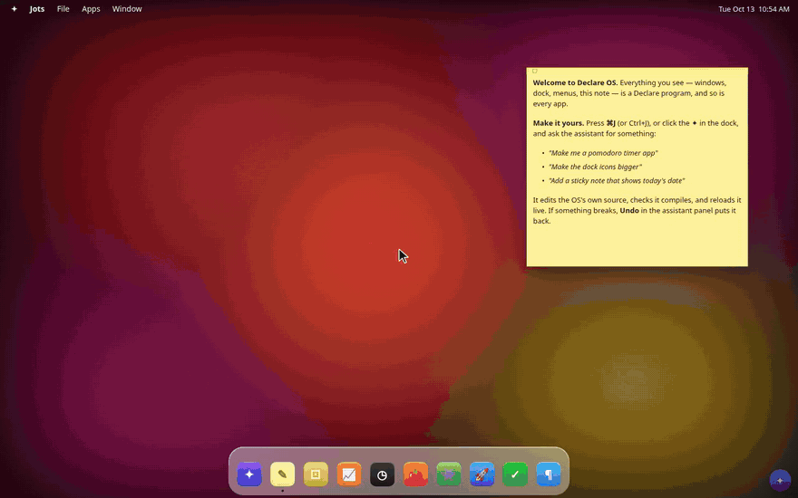

# Declare OS

A desktop OS in the browser — windows, a magnifying dock, menus, apps — written
entirely in [Declare](https://davidtemkin.github.io/declarelang/), that a local
LLM agent can rewrite while you use it. Ask for an app ("make a pomodoro
timer") or a change to the OS itself ("make the dock icons smaller"); a
[pi](https://github.com/earendil-works/pi) agent running the local Strata model edits the
Declare source, the bridge verifies it, and the OS reloads live.

<p align="center">
  <a href="docs/intro.mp4"></a>
  <br><sub>Real time except the agent's turns, which are sped up. <a href="docs/intro.mp4">MP4 version</a></sub>
</p>

```
npm install
npm start            # → http://127.0.0.1:8850/shell.declare (bound to 0.0.0.0, so http://<lan-ip>:8850 works too)
```

Needs Strata serving `qwen3.8-flash-next-iq3_s` on 127.0.0.1:8080 (pi provider
`strata`), set up with images on (`--vision gpu`) and `"input": ["text", "image"]`
on its entry in `~/.pi/agent/models.json`, so the agent can see its apps — or
any hosted model pi supports (see [Using a hosted model](#using-a-hosted-model)). Press **⌘J / Ctrl+J**, click ✦ in the dock, or the ✦ in the corner
to open the assistant.

## Using a hosted model

The agent is [pi](https://github.com/earendil-works/pi), so any model pi can
reach works in place of Strata. Set the provider's key, and name the provider
and model with `PI_PROVIDER` and `PI_MODEL`:

```
export ANTHROPIC_API_KEY=sk-ant-…
PI_PROVIDER=anthropic PI_MODEL=claude-sonnet-5-5 npm start
```

The same pattern works for pi's other built-in providers: `OPENAI_API_KEY`
with `PI_PROVIDER=openai`, `GEMINI_API_KEY` with `google`, `OPENROUTER_API_KEY`
with `openrouter`, and so on (`pi --help` lists the key variables). Once a key
is set, `pi --list-models` shows the model ids you can use and
`pi auth check --provider <name>` confirms pi can reach it. `PI_MODEL` also
takes the `provider/id` form.

For any other OpenAI-compatible server (Ollama, LM Studio, vLLM, a gateway),
add it to `~/.pi/agent/models.json` the way Strata is set up:

```json
{
  "providers": {
    "ollama": {
      "api": "openai-completions",
      "baseUrl": "http://127.0.0.1:11434/v1",
      "apiKey": "ollama",
      "models": [
        { "id": "qwen3.8:27b", "contextWindow": 131072, "input": ["text", "image"], "reasoning": true }
      ]
    }
  }
}
```

then `PI_PROVIDER=ollama PI_MODEL=qwen3.8:27b npm start`.

Notes:
- The look pass sends the model pictures of the apps it changed, so the model
  needs image input. With a text-only model, start with `LOOK=0`.
- With a provider other than `strata`, the panel's status dot no longer polls
  Strata and shows ready. To poll a local server's health endpoint anyway,
  set `STRATA_HEALTH` to its URL.
- Each turn sends the OS's source files and the agent's instructions to that
  provider.

## How it is put together

```
shell.declare        the host page (Declare). Never edited by the agent:
                       hosts the OS in an AppIsland, the assistant panel,
                       Undo, and the "last change broke the desktop" notice
os/                  the agent's workspace — one commit per turn, history in
                       state/os.git
  AGENTS.md            the agent's instructions (OS map + Declare cheat sheet)
  desktop.declare      the OS root: wallpaper, menu bar, windows layer, dock
  system/*.declare     window manager + launcher, window chrome, dock
  apps.json            the app registry (dock + Apps menu)
  apps/<id>/<id>.declare   one program per app (calculator, clock, todo, …)
server/agent.mjs     the bridge: pi --mode rpc ↔ chat over SSE, verify,
                       auto-repair, commit, undo, factory reset, app store
server/start.mjs     runs the bridge (8851) + the Declare dev server (8850,
                       proxying /api to the bridge)
state/               not checked in: os/'s turn-by-turn history (os.git), the
                       saved chats (chats/) and their pi sessions (sessions/),
                       the undo stack, and app data saved through /api/store
```

**A turn**: the shell POSTs `/api/prompt`; the bridge snapshots `os/` with git
and hands the prompt to pi (working in `os/`, with `os/AGENTS.md` as its system
prompt). pi's events stream back over `/api/events` as small chat operations.
When pi settles, the bridge runs `declare-verify` on the desktop (if any OS file
moved), on each app whose folder moved, and checks `apps.json`. Failures go back
to the agent to fix (twice at most). Once it verifies, the bridge takes a
picture of each changed app at its window size (`server/look.mjs`, headless
Chrome) and has the agent read it and fix anything visibly wrong — cut off,
blank, overlapping, unreadable — skipping apps the agent already looked at
since its last edit. The agent can take the same pictures itself with
`node ../server/look.mjs <app-id>`. Then it commits and bumps the revision; the
shell remounts the OS with that revision in its program name, so it is fetched
fresh. If the desktop itself fails to verify, the revision is not bumped — the
last good OS keeps running, and the panel offers Undo.

**What reloads**: a change that touched only apps (`apps/…`, `apps.json`)
doesn't reload the page — the OS reopens those apps' open windows in place, at
the same spot and size, on the new code (state inside them starts fresh unless
the app saves it). Any other change reloads the page, and the OS puts back the
windows it had open (it keeps them in the tab's sessionStorage, so a manual
refresh restores them too).

**Chats** are all kept: **History** in the panel lists them, and opening one
brings back its transcript and the agent's own memory of it (its pi session).

**App chats**: the ✦ in an app window's title bar opens the assistant as that
window's drawer — joined to its right edge (the left, if there's no room),
its height, in the OS's light or dark look, following the window as it moves
and hiding while another window is in front — on that app's own chat: its
latest one, or a new one. Requests there change only that app: the agent is
told so with every prompt, and if a turn changes anything outside
`apps/<id>/` or that app's own `apps.json` entry anyway, the bridge puts it
back before verifying and says so in the chat. The dock's ✦ or ⌘J returns to
the general chat.

**Undo** reverts the last agent turn as new commits; **factory reset**
(`POST /api/factory`) restores the tree at the `factory` tag — on a fresh
checkout, whatever `os/` held when the bridge first started (`AGENTS.md` is
kept as it is). To make the OS you have now the new baseline, commit `os/` here
and run `git --git-dir=state/os.git tag -f factory HEAD`.

Environment: `PI_PROVIDER`, `PI_MODEL` (default `strata` /
`qwen3.8-flash-next-iq3_s`), `PI_EXTENSIONS=1` to let pi load your extensions
and MCP servers, `LOOK=0` to skip the post-turn pictures, `CHROME` (path to
Chrome, if it isn't in `~/.cache/puppeteer`), `DECLARE_URL`, `AGENT_PORT`, `STRATA_HEALTH`.

The window chrome, dock and wallpaper are adapted from the Declare distro's
desktop example (`apps/desktop/desktop.declare`, MIT).
